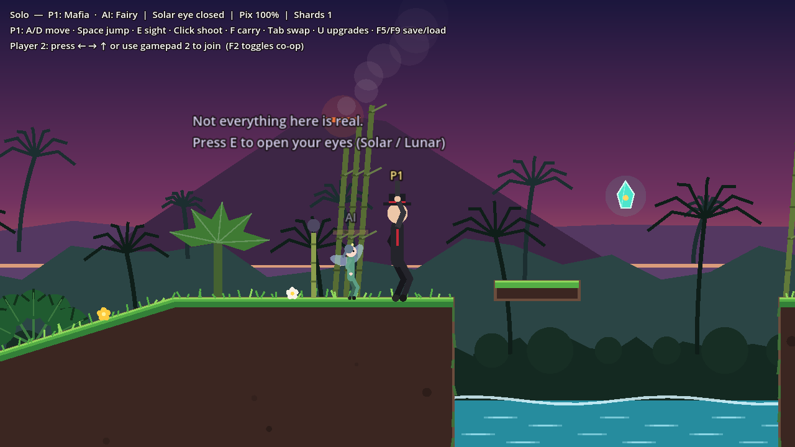
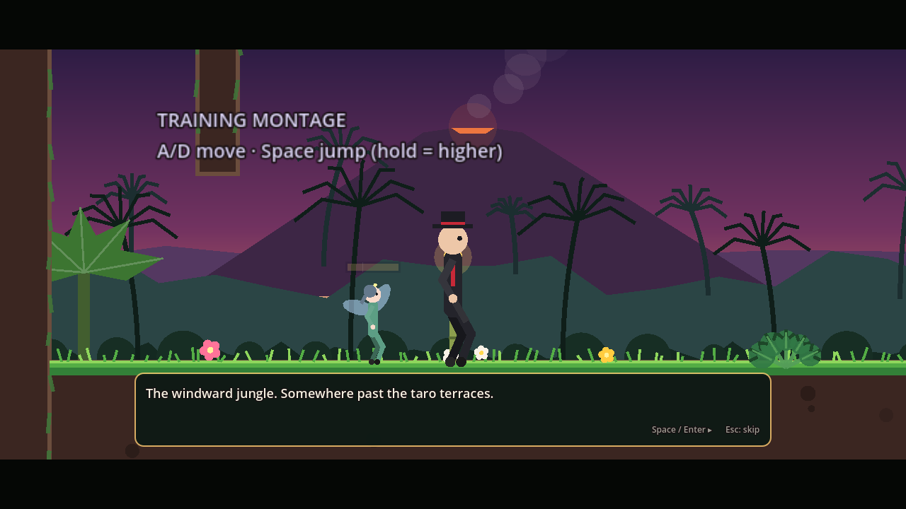
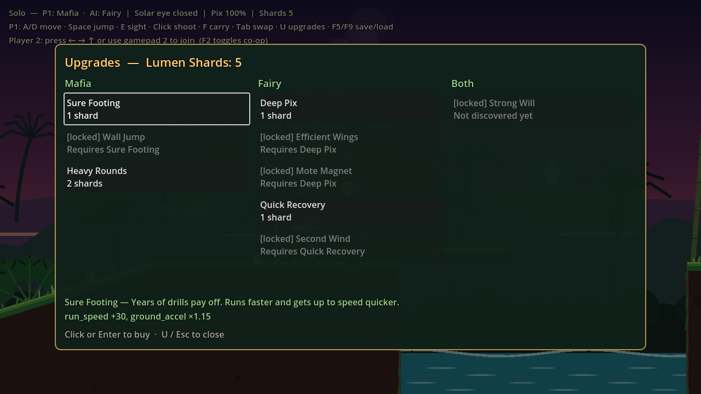
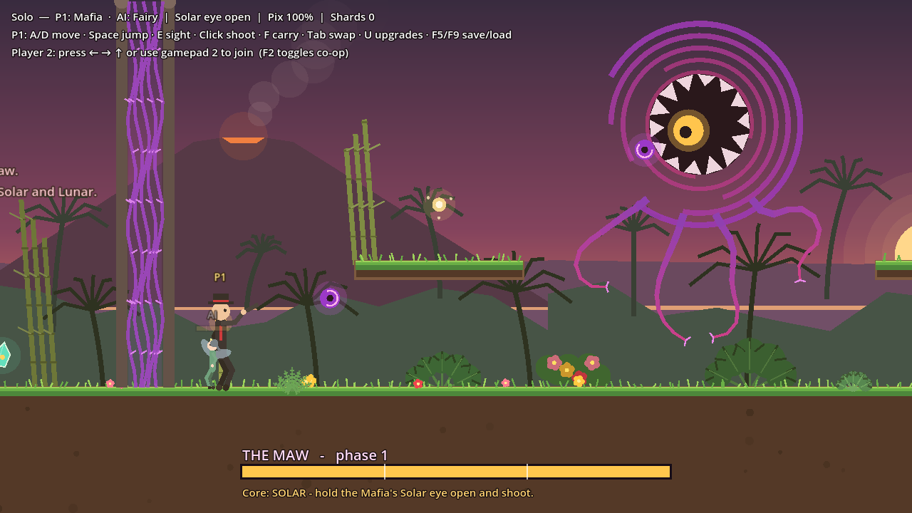
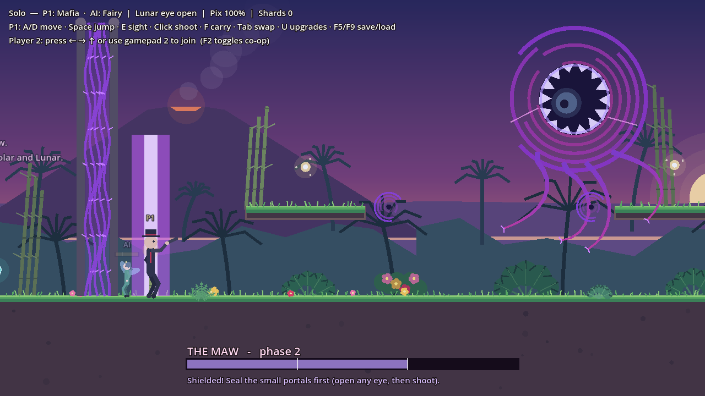
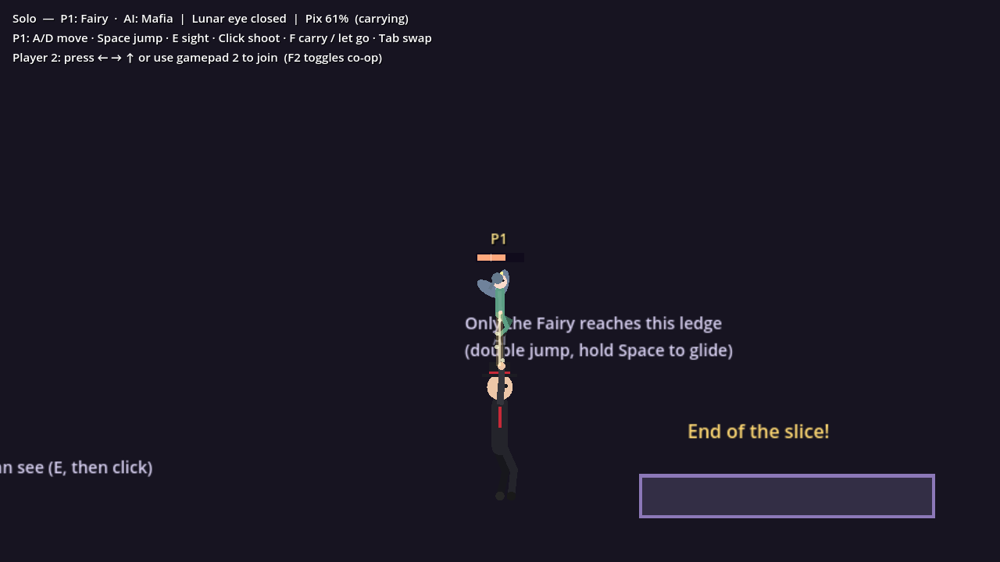
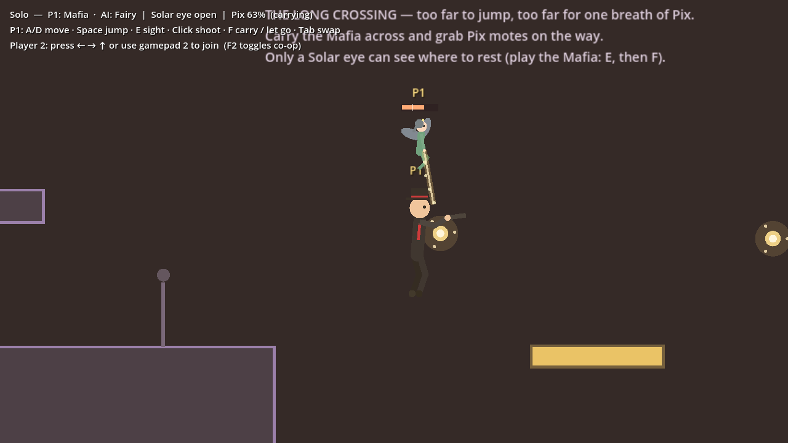
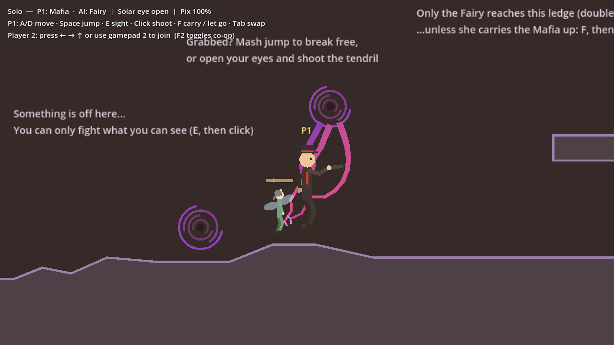
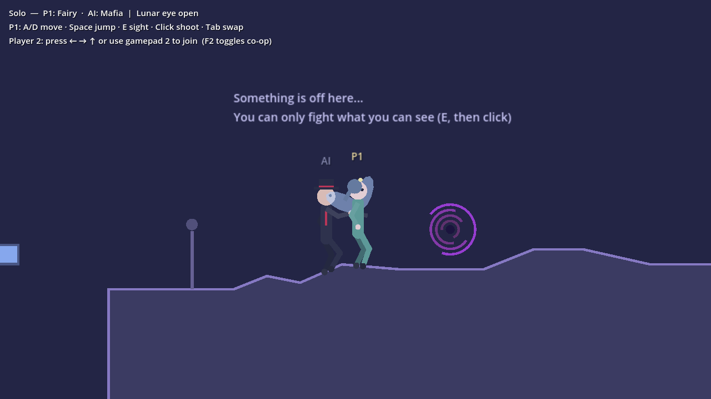
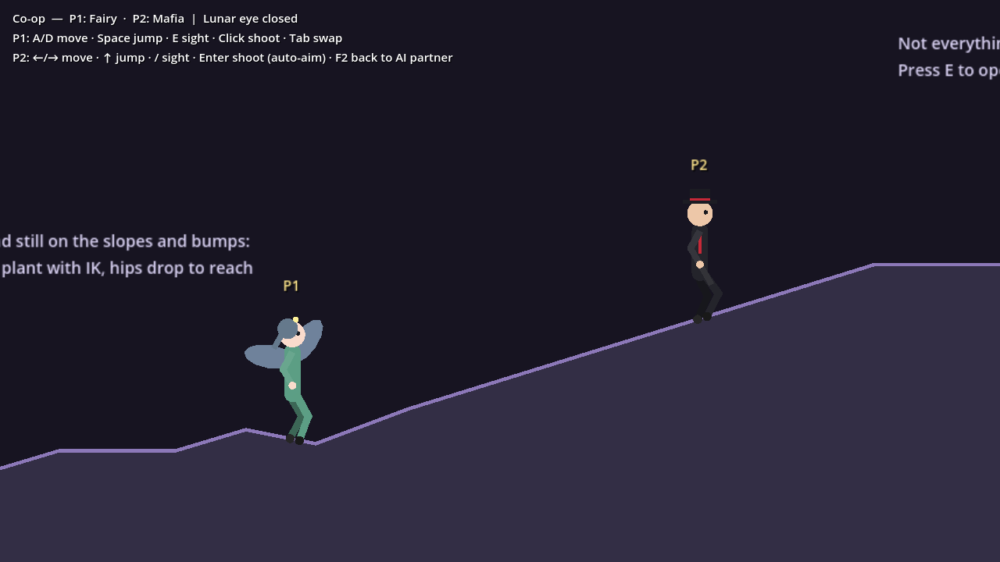

# Rift Starter — Mafia × Fairy platformer

A starter Godot 4 project for Amy's concept. It includes:

- a finished platformer controller
- both protagonists on screen together, as an AI companion or drop-in local co-op
- an IK-driven rig
- the Solar/Lunar sight mechanic
- a **cutscene engine** writers can use without code
- a modular **upgrade tree**
- a short test level set in a sunset **jungle island** that plays like the "training montage"
- a **giant portal boss**, The Maw, at the end of the level

The project **runs as soon as you open it**. It uses a procedural placeholder character, so gameplay work can start before any Spine art exists. When the Spine rig is ready, swap in `SpineRig`. No gameplay code has to change.



## Requirements

- **Godot 4.4+.** It was tested on 4.4.1 and uses the Compatibility renderer, so it runs on school lab machines.
- **Spine Professional and the spine-godot runtime.** You only need these when you switch to real Spine art. Spine *Essential* can't do IK constraints.

## Controls

| Action | Player 1 (keyboard + mouse) | Player 2 (keyboard) | Gamepad (P1 = pad 1, P2 = pad 2) |
|---|---|---|---|
| Move | A / D | ← / → | Left stick or D-pad |
| Jump (hold for a higher jump) | Space, W | ↑ | A / Cross |
| Toggle your Solar/Lunar sight | E | / | X / Square |
| Shoot (Mafia only) | Left click (aim with the mouse) | Enter or Numpad 0 (auto-aim) | Right bumper (P1 aims with the right stick) |
| Carry / let go (Fairy lifts the Mafia) | F | . (period) | B / Circle |
| Swap characters | Tab | — | Y / Triangle (P1) |
| Toggle co-op / AI partner | F2 | | |
| Upgrades menu | U | | Select / Back |
| Advance dialogue / skip cutscene | Space or Enter / Esc | | A / Start |
| Quick save / load | F5 / F9 | | |

## Cutscenes



Cutscenes are **plain text files** in `res://cutscenes/`, so the story team can write and edit them without code. See **[cutscenes/WRITING_CUTSCENES.md](cutscenes/WRITING_CUTSCENES.md)** for the writer's guide. A taste:

```
camera mafia 1.8
say Boss "Crops rotting overnight on the terraces. The farmers say a fairy did it."
move fairy -255 0.5
emote fairy "!"
if not flag met_fairy
    say fairy "An hour ago a portal nearly swallowed you. I pulled you out."
    set_flag met_fairy
end
give_shards 1
```

**What the engine does:**

- **Dialogue:** a typewriter effect and letterbox bars. The speaker's name is shown in their character's color.
- **Staging:** characters can walk to marks, face each other, jump and teleport, and floating emotes appear over their heads. The camera can follow someone or move to a spot, and there are fades.
- **Logic:** `if [not] flag | upgrade | eye | sight` with `else` and `end`, nestable.
- **Mistakes are caught:** the parser reports unknown commands, wrong argument counts, unknown actors and unknown upgrade ids with `file:line`, and refuses to play a broken file.
- **Safe skipping (Esc):** everything that changes the game (flags, shards, upgrades, sight, positions) still applies instantly. Only dialogue, waits and animation are dropped, so skipping can never break progression.
- **Control:** while a cutscene runs, the director owns both characters' inputs (`ScriptedInput`), the upgrade menu can't open, and tendrils won't grab. Afterwards everything goes back to player 1, player 2 or the AI.
- **Modular commands:** every command is registered in `scripts/cutscene/cutscene_commands.gd`. Adding one is a single `register()` call with:
  - a `run` function (which can `await`)
  - an optional instant `skip` version
  - an optional `validate` check

  The new command can then be used in any `.cutscene` file.
- **Triggers:** `CutsceneTrigger` areas play a cutscene when someone walks in, or on load with `autoplay`. They're gated by `require_flag` / `skip_if_flag` and remember they played.

**The level's four story beats:**

| Cutscene | When it plays | What it does |
|---|---|---|
| `intro` | On load | The mission briefing and the Fairy's rescue. Gives your first shard. |
| `the_gap` | Before the illusion gap | The Fairy explains sight. Reacts to which eye is open. |
| `tendrils` | Before the tendril portal | Warns about tendrils. Unlocks the Strong Will upgrade through a flag. |
| `crossing_end` | Far side of The Long Crossing | "Something big is up ahead." Gives 3 shards. |
| `boss_intro` | Entering the arena | Wakes the Maw with `emit maw_wake`. Has a branch if you own Heavy Rounds. |
| `boss_defeated` | When the Maw collapses | "To be continued...". Gives 5 shards and sets `slice_complete`. |

The Rift and both main characters' names are placeholders until the team decides.

## Upgrades



Press **U** to open the upgrade menu. It pauses the game. You spend **Lumen Shards** on upgrades. You get shards from:

- crystals hidden around the level
- sealing portals (+1 each)
- cutscenes

**How it's built:**

- **One file per upgrade.** Each is an `Upgrade` resource in `res://upgrades/`, and new files show up in the game and the menu automatically. An upgrade has:
  - an id, a name, a description and a cost
  - a target: `mafia`, `fairy` or `party`
  - `requires` (other upgrades) and `requires_flags` (story flags)
  - **stat modifiers** (`ADD`, `MULTIPLY` or `SET` on any number in `CharacterProfile`)
  - **abilities** it grants
- **Gameplay code never knows upgrades exist.** Each character's runtime `profile` is a copy of its base profile with every owned upgrade applied, rebuilt whenever an upgrade is bought.
- **Purchase order doesn't matter.** Modifiers always combine SET first, then ADD, then MULTIPLY.
- **Abilities are named switches.** Code checks them with `player.has_ability(&"wall_jump")`. Only brand-new abilities need code.
- **`Upgrades.validate()` checks every file:**
  - stats that don't exist
  - missing prerequisites
  - prerequisite cycles
  - bad targets

  The test suite runs it.
- **Status explains itself.** `Upgrades.status(id)` says why an upgrade is or isn't buyable ("Requires Sure Footing", "Not discovered yet", "Needs 2 shards"). The menu shows that text.
- **Saved progress.** `GameState` keeps flags, shards and owned upgrades, and can save and load them (F5/F9, stored in `user://save.json`).

**The starter tree:**

| Upgrade | For | Cost | Needs | Effect |
|---|---|---|---|---|
| Sure Footing | Mafia | 1 | — | +30 run speed, ×1.15 acceleration |
| Wall Jump | Mafia | 2 | Sure Footing | **Ability:** kick off walls and slide down them |
| Heavy Rounds | Mafia | 2 | — | Shots do 2 damage to portals |
| Deep Pix | Fairy | 1 | — | +40 max Pix |
| Efficient Wings | Fairy | 2 | Deep Pix | Carrying costs 25% less Pix |
| Mote Magnet | Fairy | 1 | Deep Pix | Pix motes drift to you from 140 px away |
| Quick Recovery | Fairy | 1 | — | Pix refills 50% faster, almost immediately |
| Second Wind | Fairy | 3 | Quick Recovery | +1 air jump |
| Strong Will | Both | 1 | Flag `seen_tendrils` | Each struggle counts double against tendrils |

**Shards in the level:** 7 crystals, 2 sealable portals, and 4 from cutscenes before the boss, for 13 in total. The tree costs 14, so the player has to choose before the fight. Beating the Maw gives 5 more.

One crystal sits on top of a chimney near the start. You can reach it with Wall Jump, or by having the Fairy carry the Mafia up.

**To add an upgrade:** in the FileSystem dock, right-click `upgrades/` and choose **New Resource > Upgrade**. Fill it in. That's it. `tools/build_upgrades.gd` holds the starter tree as a readable table and rebuilds those files:

```
godot --headless -s res://tools/build_upgrades.gd
```

## Boss: The Maw



A giant portal with a ring of teeth around a single eye. Its **core switches between sun and moon**, and that's the whole fight:

- When the core glows **gold (Solar)**, only someone looking with a **Solar eye** (the Mafia's) can hurt it.
- When it glows **silver-blue (Lunar)**, only a **Lunar eye** (the Fairy's) reveals it.
- Only the Mafia shoots, so the two have to cooperate:
  - **Solo:** swap with Tab so you hold the right eye open, and let the AI partner shoot. The AI fires at any open core within 900 px.
  - **Co-op:** the player with the right eye calls it.

| Phase | Health | Core | What it does |
|---|---|---|---|
| 1 | 100-67% | Solar | Four IK tendrils (the same `PortalTendril` as the level) reach down; slow homing **rift orbs** |
| 2 | 67-33% | Lunar | Spits out **two small portals**, and stays shielded until they're sealed. Drifts and fires **rift beams**: a blinking warning line, then a deadly column |
| 3 | 33-0% | Flips every 6 s | Beams plus three-orb spreads, regrown tendrils, and it **inhales** (4 s on, 3 s off), dragging everyone toward it |



**Rules:**

- Touching the Maw, a beam or an orb works like touching any portal: the solo leader goes back to a checkpoint, the partner reappears beside the leader.
- When the fight starts, everyone's checkpoint moves inside the arena. The Maw keeps the damage it has taken, so falling only costs a little time.
- Orbs can be shot down.
- Shots at an open core pass straight through idle tendrils. A tendril holding someone still blocks the shot, because saving your partner comes first.
- The upgrades matter here:
  - **Heavy Rounds** doubles your damage.
  - **Strong Will** halves the struggling.
  - **Sure Footing** helps you outrun the inhale.
  - The two **Pix motes** on the arena ledges let the Fairy lift the Mafia above the beams.
- The health bar at the bottom shows the phase and the core's color, and says what to do: "Core: LUNAR - hold the Fairy's Lunar eye open; the Mafia shoots," or "Shielded! Seal the small portals first."
- A wall of rift-vines (`ArenaGate`) seals the arena from the moment the Maw wakes until it dies. The camera pulls back to frame the party and the boss.

**How it hooks in:**

- `boss_intro.cutscene` wakes it with the new cutscene command **`emit maw_wake`**. `emit <event>` is a general-purpose signal any level object can listen for, so writers never have to know about code.
- Defeat sets the saved flag `maw_defeated` and plays `boss_defeated.cutscene`.
- Loading a save after the win keeps the Maw dead. Loading mid-fight wakes it again when you walk back in.

**Tuning:** everything is in the Inspector on the `TheMaw` node: health, size, hover height, arena bounds, tendril angles, beam timing and width, orb speed, inhale strength, how often the core flips, and the number of small portals. It's built from the same pieces as the rest of the game, so new bosses can reuse `RiftOrb`, `BossBar`, `ArenaGate` and the event hook.

## The look: a jungle island at sunset

All the art is drawn in code, so it can be swapped for painted art one piece at a time:

- **`JungleBackdrop`:** a sunset sky, a smoking volcano with a glowing crater, the sea on the horizon, and jungle hills and palm silhouettes. They scroll at different speeds for depth.
- **`Ground`:** volcanic soil with rock specks, grassy tops with tufts, hibiscus and plumeria flowers, and moss on walls.
- **`JungleDressing`:** places palms, banana plants, bamboo, monstera, ferns and hibiscus bushes along every ground top, seeded so the layout is the same every run. Tall plants go behind the action, low ferns in front. `JunglePlant` can also be placed by hand.
- **`Ocean`:** animated water in the chasms.
- **Other touches:** lanterns on bamboo poles for checkpoints, teal-and-gold Lumen Shard crystals, and outlined sign text so it stays readable over the sky.

## The Fairy is small, and she can carry the Mafia

The Fairy is about half the Mafia's size (`body_scale = 0.55` in `profiles/fairy.tres`). Her rig, collision capsule, tag and IK all scale together, so her feet still plant on slopes.

**Carrying.** Stand near the Mafia as the Fairy and press carry. She lifts him and he hangs below her on a strand of Pix light.

- Hold jump to fly up. Let go to sink slowly.
- She moves at 70% speed while carrying.
- The Mafia can still aim and shoot while he hangs.
- Press carry again to let go. He keeps the momentum.
- If he gets snagged on the level (for example, flown into a wall), he's knocked loose.

**Pix energy** limits how long she can hold him:

| | Default |
|---|---|
| Max Pix | 100 |
| Holding him | −22 per second (about 4.5 s of hovering) |
| Flying upward | an extra −20 per second (about 2.4 s of climbing, roughly 450 px) |
| Refill | +28 per second, starting 0.6 s after she lets go |
| Needed to grab | 30 |

When Pix hits 0 she drops him. The meter above her head brightens while it's in use, turns pink as it runs low, and flashes when she's below the amount needed to grab. The strand flickers in the last 25%. The HUD shows Pix as a percentage too. All of these values are in `fairy.tres` under **Carrying (Pix energy)**.

With the defaults, carrying the Mafia up to the fairy-only ledge uses about 75 of her 100 Pix. It's possible, but only just.

**Who steers:**

- If you're playing the Fairy, you fly the pair.
- If you're playing the Mafia in solo, pressing carry "calls for a lift": you steer the AI Fairy until you let go, and your mouse still aims his gun.
- In co-op, the Fairy's player flies, and either player can press carry to grab or let go.



## The Long Crossing



This section puts every mechanic to work in one place. The chasm is too wide to jump, and one full bar of Pix won't carry the Mafia all the way across.

- **A Solar-only rest platform** sits halfway across (`SightPlatform` with `for_eye = Solar`). Only the Mafia's eye can reveal it. So in solo you play the Mafia: open the Solar eye (E), then call for a lift (F) and steer the Fairy yourself.
- **Two Pix motes** float over the gap, one on each half, at the height the Mafia hangs. Brushing one tops up the Fairy by 35.
- **The route:** fly to the platform, set him down, let her Pix refill, then lift again to the far side. With the defaults, her Pix bottoms out around 24%, so it's tight but fair.
- **Sight during the lift:** the sight key opens the Mafia's Solar eye, not the Fairy's Lunar one. It follows the character player 1 is actually playing, even while they're steering the Fairy.
- **Checkpoints** sit on both sides. If the AI partner falls in, it reappears next to you.

### Pix motes

Attach `scripts/world/pix_mote.gd` to an `Area2D`. When anyone in the party touches it, the Fairy gains `amount` Pix (default 35). It comes back after `respawn_time` seconds (default 8). Its shape is created automatically.

## Portal tendrils



Portals can grow tendrils (`scripts/world/portal_tendril.gd`). Each tendril is a nine-joint chain solved with **FABRIK** (`scripts/rig/fabrik.gd`), a multi-joint IK method. The tendril's base is pinned to the portal's rim and its tip chases a target.

Each joint has a **bend limit** (`max_bend_degrees`, default 35°), so tendrils curl smoothly instead of kinking. Set it to 180 to remove the limit.

- **Idle:** it sways.
- **Reaching:** when someone comes within reach (about 150 px), the tip moves toward their chest at 240 px/s. That's slow enough to dodge by running past.
- **Grabbing:** once the tip touches you, you're caught and dragged toward the portal at 55 px/s. If you reach the portal, you die (the solo leader goes back to a checkpoint; the partner reappears next to the leader).
- **Breaking free:** mash jump 5 times and you're flung clear. Or your partner shoots the tendril, which severs it; it regrows after 3 seconds.
- **Grace period:** after getting free you have 1.2 s of immunity, so another tendril can't snatch you straight away.
- **Sight rule:** like portals, tendrils are only faintly visible with sight closed, and **they can only be shot while you can see them**. They'll still grab you when you can't see them.
- **Sealing:** sealing the portal (5 shots) makes all its tendrils let go and wither.
- **AI companion:** the AI mashes jump when it's grabbed. The AI Mafia shoots the tendrils first when they're holding someone, before shooting portals.
- **Carrying:** a grab breaks any carry.

To add tendrils to any portal, give it child `Node2D`s with `portal_tendril.gd` attached. Set `angle_degrees` (90 = straight down) and tune `segments`, `segment_length`, `reach_speed`, `pull_speed` and `grip_strength` in the Inspector.

## Playing together: AI companion and co-op

Both protagonists are always in the level together, which fits the story: they're a team.

- **Solo:** you play one character and the other follows as an **AI companion**. Tab swaps who you control, and the AI takes over the other one.
- **Drop-in co-op:** player 2 joins by pressing any of their keys (arrows, /, Enter) or anything on the second gamepad. F2 hands their character back to the AI.



**How the companion AI works** (`scripts/input/companion_ai.gd`):

- **Following.** The leader keeps a short record of where it was and when it jumped. The companion walks toward where the leader was about a quarter-second ago and repeats those jumps, so it takes the same route. This is the trick Sonic 2 used for Tails.
- **Extra rules** for what that misses:
  - It jumps when blocked by a wall, at a gap, or when the path goes up.
  - The fairy glides across gaps and uses her air jump to climb.
  - It runs a little faster when it falls behind.
  - It stops about 60 pixels short of the leader instead of walking into them.
- **Catching up.** If it's more than 650 pixels behind, stuck, or unable to reach the leader (the Mafia under the fairy ledge), it warps next to the leader. If it falls or touches a portal, it reappears next to the leader instead of at a checkpoint.
- **Helping.** The AI Mafia shoots any portal the party can currently see. So if you play the Fairy and open your Lunar eye, your partner seals the portal for you.

**Co-op rules:**

- Checkpoints are shared by both players.
- A player who falls reappears next to their partner when the partner is standing on the ground.
- If player 2 gets more than 1,100 pixels from player 1, they're pulled back.
- The camera zooms out to keep both players on screen.
- Whoever presses their sight key opens their own eye (Solar for the Mafia, Lunar for the Fairy).



## What's in the test level

1. **Training ground.** Flat ground, a slope and some bumps. Stand still on them to watch the feet plant with IK and the hips drop.
2. **The gap.** A platform you can see is an *illusion* that you fall through. The *true path* only appears when you press E. The pit below holds a portal.
3. **The blocked path.** An invisible portal kills you on contact. Open your sight to see it, then shoot it three times as the Mafia to seal it. The rule: *you can only fight what you can see.*
4. **The tendril portal.** A portal hanging over the path reaches down with three IK tendrils. See below.
5. **The fairy ledge.** It's too high for the Mafia. The Fairy's double jump gets her up there, or she can carry the Mafia (a Pix mote hangs above it).
6. **The Long Crossing.** A 700 px chasm, too wide to jump. See below.
7. **The Maw's arena.** A sealed jungle clearing with two ledges, two Pix motes and the boss.

## Project layout

```
scenes/
  main.tscn               test level
  player/player.tscn      Player (CharacterBody2D) + Rig + Tag label
scripts/
  autoload/sight.gd       global Solar/Lunar state (autoload "Sight")
  input/player_input.gd   base "intent" source + auto-aim helper
  input/human_input.gd    reads P1 or P2 actions (mouse / stick / auto aim)
  input/companion_ai.gd   AI partner: trail following, jumps, catch-up, shooting
  party/party.gd          who controls whom: solo/co-op, swap, shared respawns
  party/party_camera.gd   follows P1, or frames both players in co-op
  player/player.gd        controller: coyote time, jump buffer, variable jump,
                          air jumps, glide, aiming, hitscan shot, respawn
  player/character_profile.gd   per-character stats, size, carry + Pix tuning (Resource)
  player/pix_meter.gd     Pix energy bar over the Fairy
  party/carry_tether.gd   the glowing strand drawn while carrying
  rig/character_rig.gd    base rig interface + ground raycast helper
  rig/rig_context.gd      data the player sends the rig each frame
  rig/two_bone_ik.gd      analytic two-bone IK solver (arms, legs)
  rig/fabrik.gd           FABRIK chain IK solver (tendrils, any long chain)
  rig/placeholder_rig.gd  procedural IK stick-figure (works now)
  rig/spine_rig.gd        same interface, drives a SpineSprite
  world/ground.gd         polygon terrain that draws itself in the editor
  world/sight_platform.gd TRUE_PATH / ILLUSION platforms
  world/portal.gd         enemy portal (visible only with sight)
  world/portal_tendril.gd IK tendril: reach, grab, drag, struggle, sever
  world/pix_mote.gd       pickup that refills the Fairy's Pix
  world/shard_pickup.gd   Lumen Shard crystal (upgrade currency)
  world/decor/            jungle backdrop, plants, auto-dressing, ocean
  boss/maw_boss.gd        the Maw: states, phases, Solar/Lunar core, attacks
  boss/rift_orb.gd        homing orb (shootable)
  boss/boss_bar.gd        boss health bar + "which eye" hint
  boss/arena_gate.gd      vine wall that seals the arena during the fight
  autoload/game_state.gd  flags, shards, owned upgrades, save/load
  autoload/upgrades.gd    upgrade registry, rules, runtime profiles, validation
  autoload/cutscenes.gd   cutscene director (playback, skipping, control)
  upgrades/ (scripts)     upgrade.gd, stat_modifier.gd
  cutscene/               parser, commands, dialogue UI, triggers
  ui/upgrade_menu.gd      pause menu for buying upgrades
cutscenes/                .cutscene story files + WRITING_CUTSCENES.md
upgrades/                 one .tres per upgrade
tools/build_upgrades.gd   rebuilds the starter upgrade files
  world/checkpoint.gd     respawn points
  ui/hud.gd               sight tint + status text
profiles/
  mafia.tres, fairy.tres  tune movement here, no code needed
tests/
  smoke_test.tscn         automated checks (see below)
```

## How the pieces fit

```
PlayerInput (intent)  -->  Player (gameplay)  --RigContext-->  CharacterRig (visuals)
 ├─ HumanInput P1                                                ├─ PlaceholderRig (now)
 ├─ HumanInput P2                                                └─ SpineRig       (later)
 └─ CompanionAI
            ^ assigned by Party (solo / co-op / swap)
```

The player never reads the keyboard. It asks its `PlayerInput` for movement, jump, shoot, sight and an aim point, so the same body can be played by player 1, player 2 or the AI.

The player also never touches bones. It reports velocity, whether it's on the floor, facing, aiming, the aim point and gliding. The rig decides how to show that. The Spine version is a drop-in replacement for the same reason.

### The IK

- **Legs.** Each foot target is raycast onto the ground. While walking, a procedural gait moves the targets: feet lift on the forward swing and plant on the push-back. The hips lower so the downhill foot can still reach. Two-bone IK (`TwoBoneIK.solve`) finds the knees.
- **Aim arm.** The front hand reaches toward the mouse with IK. The gun follows the forearm, blended toward the exact aim direction.
- **In the air.** The legs tuck when jumping and trail behind when gliding. The Fairy's wings flap faster while airborne.

Turn on `Rig > Debug > Show IK Targets` in the Inspector to see the foot targets and knees.

## Swapping in Spine

1. **Install spine-godot.** Use the official runtime from Esoteric Software, either the GDExtension or their prebuilt Godot editor. The Spine editor version you export from has to match the runtime version.
2. **Rig to this contract in the Spine editor.** `spine_rig.gd` expects these names, and you can rename them in the Inspector:

   | Purpose | Bones | IK constraint | Notes |
   |---|---|---|---|
   | Aim | `aim-target` (child of root) | `aim-ik` on the front upper arm and forearm | Setup-pose **mix = 0** |
   | Left foot | `foot-l-target` | `foot-l-ik` on the thigh and shin | Setup-pose **mix = 0** |
   | Right foot | `foot-r-target` | `foot-r-ik` | Setup-pose **mix = 0** |
   | Gun tip | `muzzle` | — | Optional |

   - Animations: `idle`, `run`, `jump`, `fall`, `glide`, `aim` (arm-only overlay), `shoot`.
   - Skins: `mafia` and `fairy`, if both characters share one skeleton. Otherwise use a separate SpineSprite per character.
   - **Animate the legs and arms with normal forward kinematics (FK).** The code only fades the IK in when it's needed: aim IK while aiming, foot IK while standing still on uneven ground.
3. **Export** the skeleton as binary `.skel` plus its atlas, and drop them into the project. Create a *SpineSkeletonDataResource* from them.
4. **In `player.tscn`:**
   - Change the `Rig` node's script to `scripts/rig/spine_rig.gd`.
   - Add a `SpineSprite` child named `SpineSprite` and assign the data resource to it.
   - Position the SpineSprite so the character's feet sit on the Rig's origin.

   `SpineRig` creates the SpineBoneNodes for the IK targets and the muzzle at runtime.

`spine_rig.gd` is written against the spine-godot API (SpineSprite, SpineBoneNode, IK constraint mix, animation tracks). It **has not been run against a real rig yet**, because the project has no Spine file. Expect small fixes the first time someone plugs in a skeleton.

## Tuning feel

Open `profiles/mafia.tres` or `profiles/fairy.tres` and change the values in the Inspector: speed, acceleration, jump height, gravity, coyote time, air jumps, glide speed and colors. Both characters share one controller, so any new character is just a new profile.

## Building levels

- **Terrain:** add a `StaticBody2D`, attach `scripts/world/ground.gd`, then edit `points`. Keep slopes under 45°.
- **Sight platforms:** attach `sight_platform.gd` and choose TRUE_PATH or ILLUSION. Set `for_eye` to `Solar` or `Lunar` to make a platform that only one character can see. That gives you swap puzzles.
- **Portals:** attach `portal.gd` to an `Area2D`. It sets up its own collision.
- **Checkpoints:** attach `checkpoint.gd` to an `Area2D` placed on the ground.

## Automated checks


```
godot --headless --import
godot --headless res://tests/smoke_test.tscn
```

The test checks 166 things, including:

- the IK math (knee and elbow bend direction, reach clamping, FABRIK reaching, keeping its bone lengths, and respecting joint limits)
- input bindings
- landing, and feet planting on the slope
- swapping, running and the gait
- jump heights: the Fairy can reach the ledge and the Mafia can't
- sight platforms, sealing a portal, and respawning
- the companion following a full run up the slopes, copying jumps, catching up, and respawning next to the leader
- the AI Mafia sealing a portal that the Fairy reveals
- the small Fairy's size and foot planting
- carrying the Mafia onto the fairy-only ledge
- Pix draining at the right rate and forcing a drop, then refilling, and grabbing blocked below the minimum
- the solo "call for a lift"
- tendrils grabbing, dragging, being escaped by mashing jump, being severed only when visible, pulling you in if nobody helps, the AI Mafia freeing the Fairy, and sealing the portal releasing everyone
- Pix motes
- the Solar-only platform
- sight staying with the Mafia during a lift
- a full two-leg flight across The Long Crossing, never running out of Pix
- **upgrades:**
  - loading and validation, including catching a misspelled stat
  - prerequisite and flag locks, and costs
  - stat changes per character, stacking, and modifier order
  - whole-number stats staying whole
  - Wall Jump kicking off walls
  - Heavy Rounds, Strong Will and Mote Magnet
  - one-time shards
  - save/load restoring stats
  - buying through the menu, and the menu pausing the game
- **cutscenes:**
  - quoting and nested if/else parsing
  - error reporting with line numbers
  - every shipped file being valid
  - playback (branches, moves, rewards, control handed back)
  - Esc skipping while still applying flags, upgrades and positions
  - Space advancing dialogue
  - flag-gated, play-once and autoplay triggers
  - the menu being blocked during cutscenes
- **the boss:**
  - asleep until the intro cutscene's `emit`
  - gate, bar and camera
  - the gate blocking the exit
  - core rules: eyes closed, wrong eye, right eye, a real shot landing
  - the phase 2 shield and its small portals
  - the AI Mafia shooting the Lunar core while the Fairy holds her eye open
  - beam warning, then a hit only inside the column
  - homing and shootable orbs
  - phase 3 core flips and the inhale pull
  - defeat: flag, gate opens, camera returns, tendrils gone, reward cutscene
  - staying dead after loading
- player 2 dropping in, moving on their own, being pulled back when too far, the camera framing both, and handing back to the AI

All of them currently pass.

## Suggested next steps

1. Write the real story into `cutscenes/` with character names and the Rift reveal. The writer's guide covers everything.
2. Portraits in dialogue: add a `portrait` command in `cutscene_commands.gd` and a TextureRect in `cutscene_ui.gd`.
3. A state machine for the player as more moves arrive (grapple, dash). They can be gated as upgrade abilities, the same way Wall Jump is.
4. Boss polish: hit sounds, screen shake on phase changes, and a short roar cutscene between phases (call `Cutscenes.play_file` from the `phase_changed` signal).
5. More puzzles built around carry distance, Solar/Lunar-only paths and the chimney. The Long Crossing is the template.
6. Swap the procedural art for painted layers and TileMapLayers once the art team is ready. Each decor script is one self-contained `_draw`.
